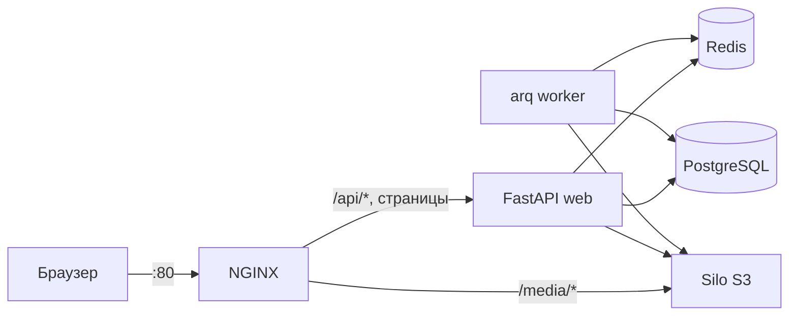

# Архитектура

> Стек зафиксирован ТЗ: Python + FastAPI, PostgreSQL, Swagger на `/docs`, простой фронт,
> Docker Compose, деплой одной командой на чистой Ubuntu.
> Остальные решения обоснованы в `docs/adr/`.

## 1. Компоненты

| Компонент | Технология | Ответственность |
|---|---|---|
| API + SSR | FastAPI (uvicorn), Jinja2-шаблоны | REST API, серверный рендеринг экранов, авторизация, проверка прав, выдача подписанных URL |
| БД | PostgreSQL 16 | users, videos, comments, likes, subscriptions, playlists, reports, sessions |
| Объектное хранилище | Silo (форк MinIO, S3-совместимый; ADR-001) | Исходники, готовые транскоды, превью |
| Фоновый воркер | arq (очередь на Redis 7) | Транскод ffmpeg, генерация превью, очистка хранилища при удалении |
| Reverse proxy | NGINX | Единая точка входа `:80`, лимит тела запроса, проксирование на API и хранилище (`/videos/`, `/thumbnails/` без rewrite с сохранением Host — для валидации presigned-подписи) |

### Размещение (docker compose, одна VM)

- `web` — FastAPI (API + страницы). Порт наружу не публикуется, только через NGINX.
- `worker` — arq-воркер, тот же образ, что `web`.
- `postgres` — БД; данные в томе.
- `redis` — очередь задач.
- `silo` — S3-хранилище (форк MinIO, образ `pgsty/silo` с зафиксированным тегом, ADR-001); данные в томе.
- `nginx` — reverse proxy, единственный опубликованный порт `:80`.
- `seed` — one-shot контейнер демо-данных, запускается по требованию (`--profile seed`).



## 2. Путь видео от загрузки до раздачи

### 2.1 Загрузка

1. Браузер отправляет `POST /api/videos` (multipart): файл + метаданные (название, описание, флаг приватности).
   Прогресс — через `XMLHttpRequest.upload.onprogress` на странице загрузки.
2. API проверяет: сессию, расширение + magic bytes (сигнатура контейнера), размер (`MAX_UPLOAD_SIZE`, по умолчанию 512 МБ), метаданные (pydantic).
3. API стримит файл в хранилище (S3 API, Silo), бакет `raw` с ключом `<uuid>`; считает SHA-256 по ходу.
4. В БД создаётся запись `videos` со статусом `processing`; в очередь кладётся задача `transcode(video_id)`.

Обоснование: прямая multipart-загрузка через API проще presigned-upload и достаточна для одного файла ≤ 512 МБ; отдача_bytes не касается БД. Подробнее — ADR-003.

### 2.2 Фоновая обработка

1. Воркер забирает задачу `transcode(video_id)` из Redis (arq).
2. Скачивает исходник из `raw` в tmp, запускает ffmpeg:
   `ffmpeg -i in -vf scale=-2:480 -c:v libx264 -preset fast -c:a aac -movflags +faststart out.mp4`
3. Кладёт результат в бакет `videos` (`<uuid>.mp4`) и превью в `thumbnails` (`<uuid>.jpg`, кадр на 1-й секунде).
4. Обновляет `videos.status = ready` (+ длительность, размеры). При ошибке после ретраев — `failed`.

Статусная модель: `processing → ready | failed`, плюс `hidden` (модерация). В лентах и поиске видны только `ready` (+ приватные владельцу).

### 2.3 Раздача

- **Готовое видео**: API после проверки прав выдаёт браузеру presigned GET URL на `videos/<uuid>.mp4` (TTL 3600 с публичные / 900 с приватные, `PRESIGNED_TTL_SECONDS` / `PRESIGNED_TTL_PRIVATE_SECONDS`). Тег `<video src=...>` играет его; перемотка работает через Range-запросы, которые S3-хранилище поддерживает (206 Partial Content).
- **Как формируется host presigned URL (за reverse proxy)**: сигнатура SigV4 покрывает host и путь, поэтому подписывать надо тем host, которым пользуется браузер. Приложение держит два клиента S3: **внутренний** (`S3_ENDPOINT=silo:9000`) — для PUT/DELETE из web и воркера; **внешний** (`S3_PUBLIC_ENDPOINT=<публичный host>:80`, `S3_PUBLIC_SECURE=false`) — только для генерации presigned URL. NGINX проксирует `location /videos/` и `location /thumbnails/` на `silo:9000` **без rewrite** (URI передаётся как есть) и с `proxy_set_header Host $host` — тогда хранилище валидирует подпись, вычисленную для публичного host. Для `demo/` и локальной разработки `S3_PUBLIC_ENDPOINT=localhost`.
- **Превью публичных видео**: отдаются через NGINX `/media/thumbnails/...` → хранилище без подписи (публичный bucket policy на чтение). Карточкам ленты подпись не нужна.
- **Превью приватных видео**: как и видео — presigned URL после проверки прав.
- Прямая ссылка на объект без подписи (для `videos`, `raw`) → 403 от хранилища; `raw`-бакет не проксируется вовсе.

## 3. Приватные видео и защита от утечки

- Проверка прав выполняется в API до выдачи любого presigned URL: `videos.is_private = true` → доступен владельцу, белому списку (`video_acl`), модераторам и админам.
- Неавторизованный запрос страницы приватного видео → 404 (не 403, чтобы не раскрывать факт существования).
- Presigned URL короткоживущие (4 ч); выдача только через проверку прав → передача ссылки другу даёт доступ лишь на время TTL, без возможности обновления.
- `raw`-бакет полностью закрыт; исходники не раздаются никогда.
- Ссылка на страницу видео не содержит ключей хранилища; ключи объектов (uuid) не угадываемы.

Остаточный риск: обладатель presigned URL может расшарить его на время TTL. Принято для простоты; альтернатива (стрим-прокси через API с проверкой каждого Range) — ADR-003.

## 4. Модель ролей и прав

Роль в `users.role` (`user | moderator | admin`), проверяется на каждом запросе из БД (сессия не кэширует роль).

| Действие | guest | user | moderator | admin |
|---|---|---|---|---|
| Просмотр публичных видео | ✅ | ✅ | ✅ | ✅ |
| Просмотр приватных видео | ❌ | владелец / белый список | ✅ | ✅ |
| Загрузка | ❌ | ✅ | ✅ | ✅ |
| Лайки, комментарии | ❌ | ✅ | ✅ | ✅ |
| Жалоба на видео | ❌ | ✅ | ✅ | ✅ |
| Очередь модерации, скрытие/возврат видео | ❌ | ❌ | ✅ | ✅ |
| Назначение ролей, блокировка пользователей | ❌ | ❌ | ❌ | ✅ |

Реализация: FastAPI-зависимости `get_current_user` → `require_role("moderator")`; для ресурсов — проверка владения/доступа на уровне сервиса.

## 5. Фоновая обработка

- Очередь: **arq** на Redis. Задачи: `transcode(video_id)`, `cleanup_video(video_id)` (удаление объектов хранилища); `retries=2` c задержкой.
- Воркер — отдельный контейнер того же образа (entrypoint `arq`); ffmpeg внутри образа.
- Идемпотентность: задача повторно ставится только при загрузке; воркер перед стартом проверяет статус видео в БД.
- Наблюдаемость: логи воркера в stdout (docker logs); статус каждого видео виден в БД и в UI владельца (`processing/ready/failed`).
- **Зачем Redis** (подробнее ADR-002): очередь задач с ретраями + счётчики rate limit (вход/регистрация). Убирает самописную очередь на PostgreSQL.

## 6. Развёртывание одной командой

`deploy.sh` на чистой Ubuntu:

1. Проверяет/ставит Docker + Docker Compose plugin (official apt-репозиторий).
2. Копирует `.env.example` → `.env` (если нет), генерирует недостающие секреты (`POSTGRES_PASSWORD`, `S3_SECRET_KEY`, `SECRET_KEY`) и сохраняет в `.env`. Один секрет `S3_SECRET_KEY` обслуживает и Silo (через переменную `MINIO_ROOT_PASSWORD` в compose), и клиентов web/worker — иначе подписи не сойдутся.
3. `docker compose build && docker compose up -d` (web, worker, postgres, redis, silo, nginx).
4. Ждёт здоровья postgres/silo, применяет миграции (контейнер миграций или `alembic upgrade head` при старте `web`).
5. Печатает URL приложения (`http://<host>/`) и напоминание про seed: `docker compose --profile seed run --rm seed`.

Всё состояние — в named volumes (`pgdata`, `silo_data`); повторный запуск идемпотентен.

## 7. Структура репозитория (план)

```text
.
├── AGENTS.md, CLAUDE.md, README.md
├── pyproject.toml, uv.lock, .env.example
├── deploy.sh                      # одна команда для чистой Ubuntu
├── docker-compose.yml
├── nginx/nginx.conf
├── docs/                          # TZ, requirements, architecture, db-schema, security, testing, plan, adr/
├── migrations/                    # alembic
├── src/app/
│   ├── main.py                    # FastAPI app, маршруты страниц
│   ├── api/                       # REST: auth, videos, comments, likes, channels, search, moderation, admin
│   ├── pages/                     # Jinja2-роуты экранов
│   ├── core/                      # config, security, deps (get_current_user, require_role), storage (S3-клиент minio-py)
│   ├── services/                  # бизнес-логика: доступ к видео, лайки, модерация
│   ├── models.py                  # SQLAlchemy-модели
│   ├── schemas.py                 # pydantic-схемы
│   ├── templates/                 # base.html + экраны
│   └── static/                    # css, js
├── src/worker/                    # arq-воркер: transcode, thumbnail
├── scripts/seed.py                # демо-данные
└── tests/                         # unit (без Docker) + integration (маркер, с Docker)
```

## 8. Фронтенд (ADR-007, реализовано 2026-11-15)

SSR на Jinja2 внутри FastAPI: все HTML-роуты в `src/app/pages.py`, шаблоны в
`src/app/templates/`, статика (CSS/JS) в `src/app/static/` и раздаётся
same-origin через `app.mount("/static")` — без CDN и внешних шрифтов (CSP
`script-src 'self'` в nginx). Весь JS — внешние файлы, без inline-скриптов
и on*-обработчиков; пользовательские данные только с автоэкранированием
Jinja (никакого `|safe`).

- `pages.py`: роуты `/`, `/search`, `/login`, `/register`, `/watch/{id}`,
  `/upload`, `/me/videos`, `/channel/{id}`, `/subscriptions`, `/playlist/{id}`,
  `/mod`; общие фильтры Jinja (`fmt_duration`, `time_ago`, `plural`);
  зависимости страниц — те же provider-функции, что у API (переопределяются
  в тестах один раз).
- Шаблоны: `base.html` (шапка: меню, логотип, поиск, загрузка, переключатель
  темы, аватар/вход; сайдбар: Главная/Подписки/Вы/Модерация; тосты),
  `home.html`+`_cards.html` (сетка карточек 16:9), `auth.html`, `watch.html`,
  `upload.html`, `my_videos.html`, `channel.html`, `subs.html`,
  `playlist.html`, `mod.html`, `error.html` (403/404/500 для браузерных
  маршрутов; API отвечает JSON).
- JS: `theme.js` (в `<head>`: тема из localStorage/prefers-color-scheme),
  `app.js` (хелпер `window.tzApi` fetch same-origin, тосты, меню/тема/выход),
  `auth.js`, `watch.js` (просмотр, лайки, подписка, комментарии, жалоба),
  `upload.js` (dropzone + XHR-прогресс + опрос статуса), `manage.js`
  (редактирование/удаление/приватность/ACL), `channel.js`, `playlist.js`,
  `mod.js` (решение жалоб, админка ролей).
- Темы: CSS-переменные в `app.css`, светлая по умолчанию, тёмная через
  `[data-theme="dark"]` и `prefers-color-scheme`; адаптив до ширины телефона.
- Стражи: `tests/test_frontend_f7.py` — нет внешних URL в шаблонах/статике,
  нет inline-скриптов/on*-обработчиков/|safe; F1–F6 — рендер страниц для
  гостя и ролей, XSS-экранирование пользовательского текста, права на /mod.
