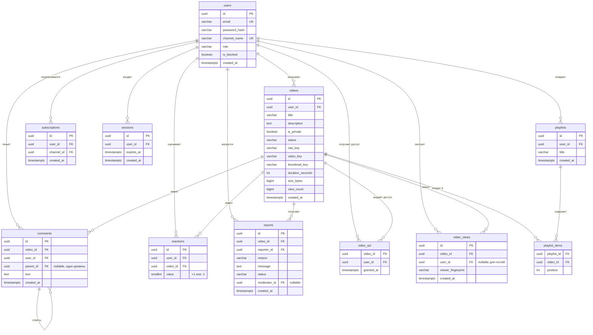

# Схема PostgreSQL

> ORM: SQLAlchemy 2.0, миграции: Alembic.
> Медиа-файлы (исходники, транскоды, превью) — в MinIO; в БД только ключи объектов.

## 1. ER-диаграмма

## 2. Таблицы

### users

| Поле | Тип | Ограничения |
|---|---|---|
| id | uuid | PK, default gen_random_uuid() |
| email | varchar(255) | UNIQUE, NOT NULL |
| password_hash | varchar(255) | NOT NULL, bcrypt |
| channel_name | varchar(100) | UNIQUE, NOT NULL |
| role | varchar(16) | NOT NULL, CHECK IN ('user','moderator','admin'), default 'user' |
| is_blocked | boolean | NOT NULL, default false |
| created_at | timestamptz | NOT NULL, default now() |

### sessions

| Поле | Тип | Ограничения |
|---|---|---|
| id | uuid | PK (значение cookie `session_id`) |
| user_id | uuid | FK → users(id) ON DELETE CASCADE |
| expires_at | timestamptz | NOT NULL |
| created_at | timestamptz | NOT NULL, default now() |

Индекс `(expires_at)` для чистки просроченных.

### videos

| Поле | Тип | Ограничения |
|---|---|---|
| id | uuid | PK, default gen_random_uuid() |
| user_id | uuid | FK → users(id) ON DELETE CASCADE |
| title | varchar(200) | NOT NULL |
| description | text | NOT NULL, default '' |
| is_private | boolean | NOT NULL, default false |
| status | varchar(16) | NOT NULL, CHECK IN ('processing','ready','failed','hidden') |
| raw_key | varchar(200) | NOT NULL — ключ исходника в MinIO |
| video_key | varchar(200) | NULL — ключ транскода; NOT NULL при status='ready' (проверка приложением) |
| thumbnail_key | varchar(200) | NULL — ключ превью |
| duration_seconds | int | NOT NULL, default 0 |
| size_bytes | bigint | NOT NULL, default 0 |
| view_count | bigint | NOT NULL, default 0 |
| created_at | timestamptz | NOT NULL, default now() |

Индексы:

- `(status, created_at DESC)` — лента;
- `(user_id, created_at DESC)` — канал;
- частичный `(created_at DESC) WHERE status='ready' AND NOT is_private` — главная;
- GIN по `title` с `pg_trgm` — поиск ILIKE.

### video_views

| Поле | Тип | Ограничения |
|---|---|---|
| id | uuid | PK |
| video_id | uuid | FK → videos(id) ON DELETE CASCADE |
| user_id | uuid | FK → users(id) ON DELETE CASCADE, NULL для гостей |
| viewer_fingerprint | varchar(64) | NOT NULL — user_id либо cookie-id гостя |
| created_at | timestamptz | NOT NULL, default now() |

Дедупликация «раз в 24 ч» — логикой приложения: ищем запись с тем же `(video_id, viewer_fingerprint)` за последние 24 ч; если нет — вставляем и инкрементируем `videos.view_count` в той же транзакции.

### reactions

| Поле | Тип | Ограничения |
|---|---|---|
| id | uuid | PK |
| user_id | uuid | FK → users(id) ON DELETE CASCADE |
| video_id | uuid | FK → videos(id) ON DELETE CASCADE |
| value | smallint | NOT NULL, CHECK IN (1, -1) |
| created_at | timestamptz | NOT NULL, default now() |

UNIQUE(user_id, video_id): одна реакция на пользователя; повтор — переключение или снятие.

### comments

| Поле | Тип | Ограничения |
|---|---|---|
| id | uuid | PK |
| video_id | uuid | FK → videos(id) ON DELETE CASCADE |
| user_id | uuid | FK → users(id) ON DELETE CASCADE |
| parent_id | uuid | NULL, FK → comments(id) ON DELETE CASCADE; один уровень вложенности |
| text | text | NOT NULL, до 2000 символов |
| created_at | timestamptz | NOT NULL, default now() |

Индекс `(video_id, created_at)`.

### subscriptions

| Поле | Тип | Ограничения |
|---|---|---|
| id | uuid | PK |
| user_id | uuid | FK → users(id) ON DELETE CASCADE — кто подписан |
| channel_id | uuid | FK → users(id) ON DELETE CASCADE — на кого |
| created_at | timestamptz | NOT NULL, default now() |

UNIQUE(user_id, channel_id); CHECK (user_id <> channel_id).

### playlists

| Поле | Тип | Ограничения |
|---|---|---|
| id | uuid | PK |
| user_id | uuid | FK → users(id) ON DELETE CASCADE |
| title | varchar(200) | NOT NULL |
| created_at | timestamptz | NOT NULL, default now() |

### playlist_items

| Поле | Тип | Ограничения |
|---|---|---|
| playlist_id | uuid | FK → playlists(id) ON DELETE CASCADE, PK входит |
| video_id | uuid | FK → videos(id) ON DELETE CASCADE |
| position | int | NOT NULL |

UNIQUE(playlist_id, video_id); UNIQUE(playlist_id, position). Порядок пересчитывается приложением при изменениях.

### reports

| Поле | Тип | Ограничения |
|---|---|---|
| id | uuid | PK |
| video_id | uuid | FK → videos(id) ON DELETE CASCADE |
| reporter_id | uuid | FK → users(id) ON DELETE CASCADE |
| reason | varchar(32) | NOT NULL, CHECK IN ('spam','harassment','violence','other') |
| message | text | NULL, до 1000 символов |
| status | varchar(16) | NOT NULL, default 'new', CHECK IN ('new','resolved','dismissed') |
| moderator_id | uuid | NULL, FK → users(id) ON DELETE SET NULL |
| created_at | timestamptz | NOT NULL, default now() |

Индекс `(status, created_at)` — очередь модерации.

### video_acl

| Поле | Тип | Ограничения |
|---|---|---|
| video_id | uuid | FK → videos(id) ON DELETE CASCADE, PK входит |
| user_id | uuid | FK → users(id) ON DELETE CASCADE, PK входит |
| granted_at | timestamptz | NOT NULL, default now() |

PK (video_id, user_id) = уникальность пары.

## 3. Что где хранится

| Данные | Где | Почему |
|---|---|---|
| Метаданные, права, реакции, комментарии, сессии | PostgreSQL | Транзакционность, связи, индексы |
| Видеофайлы (raw, транскоды), превью | MinIO | Большие бинарные объекты, presigned URL, Range-запросы |
| Счётчик просмотров | videos.view_count (denormalized) | Быстрая выдача в ленте; обновляется в транзакции с video_views |
| Логи | stdout контейнеров | Стандартный Docker logging |

## 4. Миграции

- Alembic; сущности группируются по смыслу (auth, videos, social, moderation).
- Обязательный `downgrade()` в каждой миграции.
- `alembic upgrade head` выполняется при старте web-контейнера до запуска uvicorn — чистая Ubuntu получает схему автоматически.

## 5. Целостность

- Все FK — ON DELETE CASCADE, кроме `reports.moderator_id` (SET NULL) — история модерации сохраняется.
- Cookie `session_id` содержит UUID записи `sessions`; при логауте запись удаляется.
- `videos.video_key`/`thumbnail_key` заполняются воркером только после успешного транскода; статусная модель согласована с приложением.
